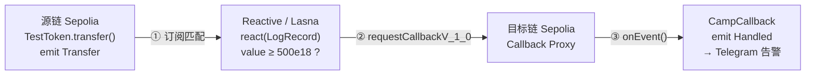

# 用例拆解卡｜大额转账告警：Reactive 适合解决什么问题

- **一句话**：链上发生大额转账 → Reactive 合约自己看到并判断 → 在目标链发一条可核验的告警记录。
- **选用例**：场景手册「场景 1｜链上监控：大额转账 / 代币流量」的自己的版本。
- **真实地址**：本卡用的是我在共学 D3 已部署并跑通的合约，不是假想。

## 四问四答

### 1. 监听哪条链、哪个合约的什么事件？

| 项 | 值 |
|---|---|
| 源链 | Ethereum Sepolia，chainId `11155111` |
| 合约 | 我部署的测试 ERC-20 `TestToken`：`0xfb7553bbe806f3e13e712b8171666b6e9f6280f5` |
| 事件 | `Transfer(address indexed from, address indexed to, uint256 value)` |
| topic0 | `0xddf252ad1be2c89b69c2b068fc378daa952ba7f163c4a11628f55a4df523b3ef` |
| 订阅参数 | `SYSTEM.subscribe(11155111, tokenAddr, TRANSFER_TOPIC0, REACTIVE_IGNORE, REACTIVE_IGNORE, REACTIVE_IGNORE)` |

`from` / `to` 是 indexed，进 topic1 / topic2；`value` 不是 indexed，在 `log_.data` 里，用 `abi.decode(log_.data, (uint256))` 取。

### 2. 满足什么条件时触发？

`amount >= 500 * 10^18`（测试币 18 位小数，即 500 token）。

注意：订阅只做**精确相等**匹配，表达不了「大于 500」；阈值判断必须在 `react()` 里做，低于阈值直接 `return`（**不能 revert，revert 照样收费**）。

再加两条保护：同一地址短时间连续大额转账只告警一次（冷却时间用 `block.timestamp`，不用区块数）；单次与累计告警额度设上限，避免被垃圾事件刷爆余额。

### 3. 在哪条链做什么动作？

| 项 | 值 |
|---|---|
| Reactive 侧 | Lasna（chainId `5318007`），我的合约 `0x789312d59c59fab7d3dc5914041ea6308828061f`，预存 0.5 lREACT |
| 目标链 | Sepolia（测试网配测试网，这里源链和目标链同链是允许的） |
| 回调合约 | `0x3b1f497e6b051a3b391c82d32d0a0f25e1ed6f74`，带 0.02 ETH 支付回调 gas |
| 动作 | 调用 `onEvent(address,uint256,uint256,uint256)`，记下源链 txHash 和金额，emit `Handled` 事件；链下小脚本/webhook 监听 `Handled` 推 Telegram |

回调第一参数必须是 `address(0)` 占位，网络替换成 Reactive 合约地址；合约里用 `onlyServiceProvider` + `onlyCallbackSender` 两道校验确认「确实是本链 Proxy 投递的、确实是这个 Reactive 合约发的」。

### 4. 不用 Reactive 要怎么做？Reactive 简单在哪、代价是什么？

**不用 Reactive**：写一个 Node/Python 机器人——RPC 轮询 `eth_getLogs` 或用 WebSocket 订阅 → 本地解析 `Transfer` → 判断金额 → 用热钱包私钥签名发告警交易。代价：服务器要 7×24 在线、掉线就漏单、热私钥放服务器上是持续风险、`eth_getLogs` 按区间扫描会漏块或被 RPC 限流、还得自己写监控和重启逻辑。

**用 Reactive**：只写一个合约，在构造函数里订阅；网络自己匹配事件并调用 `react()`，条件满足就请求回调。没有服务器、没有热私钥、链上可核验。

**代价**（说清楚才算想明白）：
- 每次匹配事件都收费，含固定 K = 100,000 gas 底噪（Lasna 实测 `fee = p_base × 1 × (g_used + 100000)`）；订阅越宽越烧钱，所以给自动化设次数上限、处理完就退订。
- `debt > 0` 合约就静默停摆，得监控余额并 `depositTo` 充值。
- 订阅只支持精确相等，范围/比较必须在 `react()` 里写。
- 回调和源链事件是两笔交易，不保证原子；告警只是提醒，不能阻止已经发生的转账。
- 约 1 秒出块的延迟，不适合毫秒级抢跑场景。

## 简图：源链 → Reactive → 目标链

```
源链 Origin (Sepolia / 11155111)
  TestToken 0xfb7553…80f5
  emit Transfer(from, to, value=500e18)
  topic0 = 0xddf252ad…23b3ef
          │
          │  ① SYSTEM.subscribe 匹配：chainId + 合约地址 + topic0
          ▼
Reactive Network (Lasna / 5318007)
  CampReactive 0x789312…061f
  react(LogRecord log_)  onlySystem
    ├─ log_.topic0 匹配
    ├─ value = abi.decode(log_.data,(uint256))
    ├─ value < 500e18 → return（不 revert）
    └─ value ≥ 500e18 → requestCallbackV_1_0(...)
          │  payload 首参 address(0) 占位 → 网络注入合约地址
          │  ② Callback Proxy 0xAa14…D23b4 投递
          ▼
目标链 Destination (Sepolia / 11155111)
  CampCallback 0x3b1f…6f74
  onEvent(reactive_, chainId_, txHash_, value_)
    ├─ onlyServiceProvider    ← 只认本链 Proxy
    ├─ onlyCallbackSender     ← 只认这个 Reactive 合约
    └─ emit Handled(...)      ← 链下脚本监听并推 Telegram
```



## 已跑通的真实交易（不是设想）

| 环节 | 交易哈希 |
|---|---|
| ① 源链 Transfer | `0x8e024ae7b4ebf543fb5778b7e03d522e36dbb58e5f73400a34fb68f94b3f4034` |
| ② Lasna react() | `0xf00ae83fc2476d63a4b2cc6a48ae1ecc42aa8b6767982cf3d7e97e42a361abea` |
| ③ 目标链 Handled | `0x1b0df3555ddf2c042280015f24051f181bcb0f194176d34899e9d11d53177671` |

详见：[D3 笔记](2026-11-18.md)。

## 一句话结论

**Reactive 适合「链上已经发生的事实 → 需要另一条链做动作」这种自动化**：它把「盯链 + 判断 + 发交易」搬进合约，省掉服务器和私钥托管；代价是每次事件都要付费、有固定底噪、只能精确匹配，且跨链回调不原子。不适合依赖链下数据、要求毫秒级原子性、或高频到账单压不住的场景。
